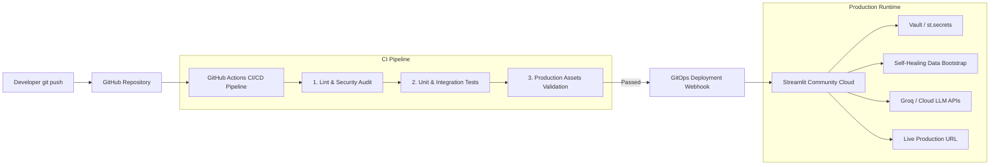

# 🚀 Production Deployment & CI/CD Guide

This guide provides a comprehensive overview of deploying the **AI-FDE Supply Chain Assistant** to production using **Streamlit Community Cloud** (100% Free) and **GitHub Actions** (CI/CD Pipeline).

---

## 🏗️ Architecture: How Production AI Deployment Works

In real-world enterprise engineering, deploying an AI agent is divided into three distinct stages:



1. **Continuous Integration (CI)**: Ensures every commit is validated, dependencies resolve, security guardrails block malicious queries, and no secrets are leaked.
2. **GitOps Continuous Deployment (CD)**: The production hosting environment listens to GitHub webhooks. When code merges to `main` and passes CI, the production instance rebuilds with zero downtime.
3. **Self-Healing Bootstrap**: The app automatically detects if local caches, DuckDB tables, or vector indexes are missing, generating them on cold boot.

---

## 🛠️ Step-by-Step Production Deployment (Streamlit Community Cloud)

### Step 1: Sign In to Streamlit Community Cloud
1. Navigate to **[share.streamlit.io](https://share.streamlit.io)**.
2. Sign in with your **GitHub account** (`sayedmizan1`).

---

### Step 2: Deploy New App
1. Click the **"New app"** button.
2. Configure the deployment settings:
   - **Repository**: `sayedmizan1/AI-FDE`
   - **Branch**: `main`
   - **Main file path**: `src/ui.py`
   - **App URL**: Choose a custom subdomain (e.g., `ai-fde-logistics.streamlit.app`)

---

### Step 3: Configure Production Secrets & Environment Variables
In production, **never** commit `.env` files. Streamlit Community Cloud provides an encrypted secrets manager:

1. In the deployment modal, expand **"Advanced settings..."** (or go to App Settings > Secrets).
2. Paste the following configuration in TOML format:

```toml
# LLM Reasoner Configuration (Groq is recommended for lightning-fast free inference)
Agent_llm = "GROQ"
GROQ_API_KEY = "gsk_your_actual_groq_api_key_here"
GROQ_MODEL = "openai/gpt-oss-120b"

# Embeddings Configuration
Embeddings_model = "LOCAL"
Local_Embedding_Model = "BAAI/bge-m3"

# Optional SQL Server Configuration (leave blank or fill if you have cloud DB)
SQL_SERVER_HOST = "localhost"
SQL_SERVER_PORT = "1433"
SQL_ADMIN_USER = "sa"
SQL_DATABASE = "SupplyChainDB"
```

3. Click **"Deploy!"**.

Streamlit Cloud will:
- Clone your repository.
- Install dependencies from `requirements.txt`.
- Execute `src/ui.py`.
- Run the automatic self-healing bootstrap (`src/bootstrap.py`) to initialize the DuckDB semantic view and vector stores.

---

## 🔄 Understanding Your CI/CD Pipeline (`.github/workflows/ci.yml`)

Your repository contains an automated CI/CD pipeline running on GitHub Actions:

| Job | Purpose | What it Checks |
| :--- | :--- | :--- |
| **🔍 Lint & Security Audit** | Code hygiene & secret safety | Checks code syntax with `ruff` and asserts no `.env` files or credentials are tracked in git. |
| **🧪 Unit & Integration Tests** | Quality assurance | Runs unit test suite (`tests/test_fde.py`), verifying SQL injection guardrails, safe query validation, corridor telemetry API, and LangGraph graph integrity. |
| **🚀 Production Readiness** | Deployment gatekeeper | Confirms `src/ui.py`, `.streamlit/config.toml`, `requirements.txt`, and `.env.example` are present. |

### How Continuous Delivery Triggers:
Whenever you push changes or merge a pull request into `main`:
1. GitHub Actions runs all test suites.
2. Streamlit Community Cloud automatically pulls the new commit and redeploys the live application seamlessly.

---

## 📊 Production Monitoring & Debugging
- **Live Logs**: Click the "Manage App" icon in the lower-right corner of your Streamlit Cloud app to inspect real-time server logs, resource usage, and exceptions.
- **Restarting**: You can trigger a reboot anytime via **App Settings > Reboot App**.
