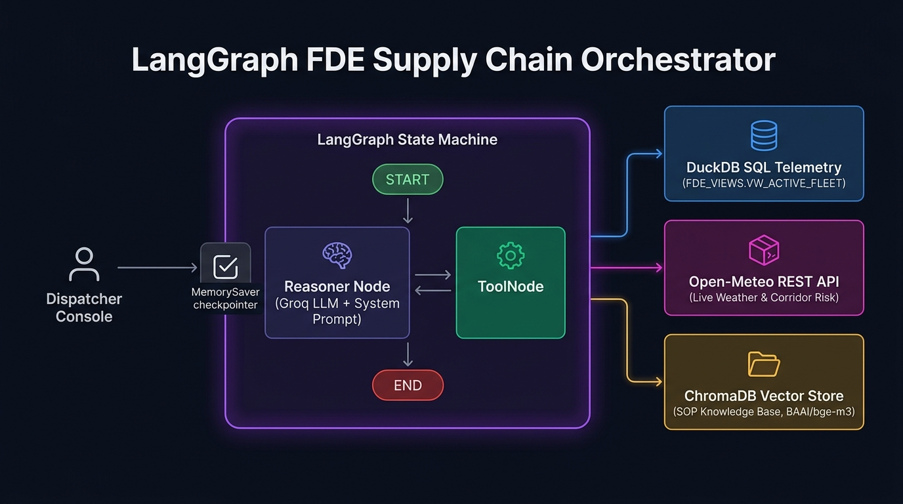
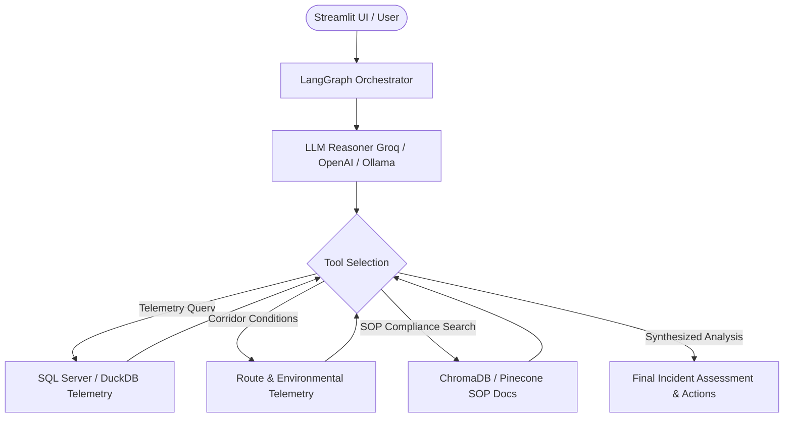

# AI-FDE: Autonomous Cold-Chain Logistics Incident AI-Assistant

An intelligent multi-agent assistant designed for autonomous supply chain risk monitoring, cold-chain incident investigation, telemetry analysis, and compliance verification.



---

## 🚀 Key Capabilities

- **Autonomous Incident Orchestration**: Built with **LangGraph** StateGraph, coordinating between telemetry databases, weather/route conditions, and compliance standard operating procedures (SOPs).
- **Multi-Modal LLM Support**: Modular factory initialization supporting **Groq** (`gpt-oss-120b`, `llama-3.3-70b-versatile`), **OpenAI** (`gpt-4o`), and local **Ollama** models.
- **Enterprise RAG & Hybrid Vector Search**:
  - Local embeddings via **BAAI/bge-m3** (Hugging Face) with **ChromaDB**.
  - Cloud-scale vector search integration with **Pinecone**.
- **Secure Telemetry Querying**: Reads from SQL Server / DuckDB with role-based access control and strict read-only execution patterns.
- **Interactive Streamlit UI**: Real-time telemetry visualization, chat interface, execution tracing, and compliance reporting.

---

## 🏗️ System Architecture



---

## 📂 Project Structure

```text
├── .github/
│   └── workflows/ci.yml     # Automated CI/CD Pipeline (Linting, Tests, Deploy checks)
├── .streamlit/
│   └── config.toml          # Production theme & server configuration
├── data/
│   ├── policy/              # Standard Operating Procedures (Cold-Chain SOP v2)
│   └── raw/                 # Logistics & shipment telemetry datasets
├── script/
│   ├── ingest_legacy_data.py       # SQL Data ingestion & DuckDB conversion pipeline
│   ├── ingest_sop_pinecone.py      # SOP chunking & vector store ingestion
│   ├── secure_db_client.py         # Read-only database access layer
│   └── setup_security_and_view.sql # Role & View security scripts for SQL Server
├── src/
│   ├── prompts/
│   │   └── system_prompt.txt       # Reasoner instructions and guardrails
│   ├── agent_tool.py               # Custom LangChain agent tools
│   ├── bootstrap.py                # Self-healing database & vector initialization
│   ├── orchestrator.py             # LangGraph state machine & execution loop
│   └── ui.py                       # Streamlit application interface
├── tests/
│   └── test_fde.py                 # Automated unit tests & security guardrail validation
├── DEPLOYMENT.md            # Step-by-step production deployment & secrets guide
├── requirements.txt
├── .env.example
└── .gitignore
```

---

## 🛠️ Getting Started

### 1. Clone the Repository
```bash
git clone https://github.com/sayedmizan1/AI-FDE.git
cd AI-FDE
```

### 2. Set Up Virtual Environment & Dependencies
```bash
python -m venv .venv
# On Windows:
.venv\Scripts\activate
# On Linux / macOS:
source .venv/bin/activate

pip install -r requirements.txt
```

### 3. Environment Configuration
Copy `.env.example` to `.env` and fill in your credentials:
```bash
cp .env.example .env
```

Configure:
- `GROQ_API_KEY` or `OPENAI_API_KEY`
- Database host, port, user, and password
- Embeddings provider (`LOCAL` or `PINECONE`)

### 4. Run the Application
Launch the Streamlit dashboard:
```bash
streamlit run src/ui.py
```

---

## 🚢 Production Deployment & CI/CD
For end-to-end production setup (Streamlit Community Cloud + GitHub Actions CI/CD):
👉 **See the complete [DEPLOYMENT.md](DEPLOYMENT.md) guide** for architecture diagrams, secrets configuration, and automated GitOps continuous deployment.

---

## 🧪 Running Automated Tests
```bash
python -m unittest tests/test_fde.py
```

---

## 📄 License
This project is licensed under the MIT License.
